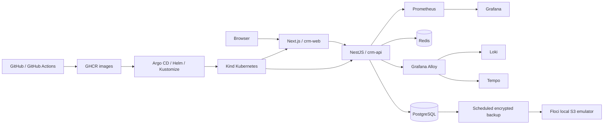

# CRM Platform — Cloud-Native Multi-Tenant CRM

A Next.js + NestJS customer relationship manager demonstrating full-stack software delivery and DevOps workflows on Kubernetes. Users can register an organization, sign in, manage contacts, and search their own organization's contacts.

## Architecture



## Stack

- **Frontend:** Next.js, TypeScript, Tailwind CSS.
- **API:** NestJS, JWT authentication, Drizzle ORM, organization-scoped contact access.
- **Data:** PostgreSQL and Redis.
- **Delivery:** Docker, GitHub Actions, GHCR, Helm, Kustomize, Argo CD, Kind Kubernetes.
- **Observability:** Prometheus, Grafana, Alertmanager, Loki, Alloy and Tempo.
- **Recovery:** Automated PostgreSQL backups, age encryption, checksum verification and isolated restore testing; local Floci S3 emulation.
- **Infrastructure as code:** Terraform.

## Local deployment

Prerequisites: Docker, Kind, kubectl, Helm and an existing cluster with the CRM API, PostgreSQL and Redis deployed. See `deploy/` and `infra/` for infrastructure configuration.

Forward the running frontend:

```bash
kubectl -n crm port-forward svc/crm-web 3001:80
```

Open <http://localhost:3001>. Grafana can be forwarded separately using `kubectl -n observability port-forward svc/kps-grafana 3000:80`.

To run the frontend from source instead, forward the API and start Next.js:

```bash
kubectl -n crm port-forward svc/crm-api 8080:80
# another shell
cd apps/web
printf 'CRM_API_URL=http://127.0.0.1:8080\nCRM_WEB_ORIGIN=http://localhost:3001\n' > .env.local
npm ci && npm run dev -- -p 3001
```

## CI/CD and GitOps

The API workflow runs builds, tests, image/security scans and Kubernetes/Terraform checks. Its release automation raises a pull request updating the digest-pinned local API deployment. The frontend workflow in `.github/workflows/crm-web.yml` builds and scans the Next.js container and, on merges to `main`, publishes to GHCR before opening a separate frontend release PR. Merging a release PR updates the Argo CD desired state. This process intentionally separates publishing from deployment.

**For local Kind**, the GHCR packages must be pullable by the cluster (public packages or configured `imagePullSecrets`). The existing `CRM_WEB_ORIGIN=http://localhost:3001` is for local port-forwarding, not a public production domain.

## Verification

Run the disposable API/tenant-isolation smoke test (creates two test organizations/users; removes its contacts):

```bash
bash scripts/test-crm-e2e.sh
```

Then check the Next.js UI: sign up, sign in, create, edit, delete and search for contacts. Refresh to verify persistence, log out and confirm the dashboard requires authentication.

## Screenshots

Add screenshots to `docs/screenshots/` and reference them here after review:

- CRM sign-in and contacts dashboard.
- Grafana CRM operations dashboard.
- Argo CD applications showing Synced / Healthy.

## Scope and limitations

This is a local Kind-based **portfolio implementation**, not a public production SaaS. The backup destination is a **local Floci S3 emulator**, not an independent off-site recovery target. Production deployment requires HTTPS, public-domain origin/cookie configuration, reliable image registry access, off-host backups, and additional security/operational validation.
